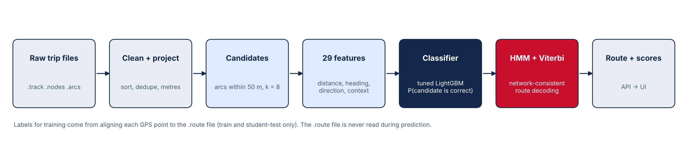

# PathSnap: map-matching and route reconstruction

PathSnap matches noisy GPS tracks to a road network and reconstructs the driven route.

Pipeline: GPS track → candidate road arcs within 50 m → 29 engineered features per (GPS point, candidate) → LightGBM classifier (probability that the candidate is the reference arc) → HMM/Viterbi decoding over the road network → reconstructed route. A FastAPI backend (Laptop 1) serves predictions and server-side scores; a browser UI (Laptop 2) displays them.



## Results (student-test partition, 10 trips)

| System | Top-1 accuracy | Route continuity | Route segment F1 |
|---|---|---|---|
| Nearest arc baseline | 0.538 | | |
| Final LightGBM, classifier only | 0.913 | 0.941 | 0.902 |
| Final LightGBM + HMM/Viterbi | **0.938** | **0.978** | **0.933** |

Full tables: `results/model_comparison.csv`, `results/hmm_vs_classifier_student_test.csv`. Report: `REPORT.docx`.

How the final model was reached:

1. Five model families (Logistic Regression, KNN, Random Forest, MLP, LightGBM) were compared on an identical 22-feature set with 5-fold GroupKFold cross-validation. LightGBM tied Random Forest on accuracy and was chosen for speed and model size.
2. Bayesian optimisation (Optuna TPE, 30 trials) tuned LightGBM on the 22-feature set: +0.12 CV points.
3. Error analysis showed most errors were the right road in the wrong direction at low speed. Seven direction features were added (29 total). With the same tuned hyperparameters, CV top-1 rose from 0.886 to 0.921 (`results/feature_ablation_direction.json`).
4. The final model is tuned LightGBM on 29 features: `artifacts/final_model.joblib`.

## Repository layout

| Folder | Contents |
|---|---|
| `pathsnap/` | Library: loading and projection (`data.py`), per-point label derivation (`labels.py`), candidates and 22 base features (`candidates.py`), 7 direction features (`direction.py`), dataset building and cache (`pipeline.py`), metrics (`metrics.py`), model registry (`models.py`, `registry_view.py`), HMM/Viterbi (`hmm.py`), inference and server-side scoring (`inference.py`) |
| `scripts/` | Numbered experiment and figure scripts (see below) |
| `api/` | FastAPI backend (`app.py`) |
| `ui/` | Evaluator UI (`index.html`, `style.css`, `app.js`, bundled Leaflet in `vendor/`) |
| `artifacts/` | `final_model.joblib`, `best_lgbm_params.json`, `hmm_config.json`, every model in `models/`, out-of-fold probabilities |
| `results/` | CSV/JSON results, logs, Optuna trials, error analysis, archived 22-feature runs |
| `figures/` | Every plot used in the report |
| `maps/` | Folium HTML maps |
| `docs/` | UI screenshot and a sample of API logs from a local end-to-end test |
| `data/` | Raw data (not committed). Put `train/`, `student_test/`, `evaluator_test/` here |

## Deliverables checklist → files

| Required component | Where |
|---|---|
| Data processing (read, inspect, clean) | `pathsnap/data.py`, `pathsnap/labels.py`, `pathsnap/pipeline.py`, `scripts/01_eda.py`, `scripts/02_build_dataset.py`, `scripts/12_show_preprocessed.py` |
| Feature engineering | `pathsnap/candidates.py` (candidates + 22 features), `pathsnap/direction.py` (7 direction features), `scripts/15_direction_experiment.py` (ablation) |
| Model training (every model) | `pathsnap/models.py`, `scripts/03_train_models.py` (5 models), `scripts/04_bayes_opt.py`, `scripts/18_lightgbm_final.py` |
| Model evaluation, metrics, plots, confusion matrices | `pathsnap/metrics.py`, `scripts/08_compare_plots.py`, `scripts/19_model_cards.py`, `scripts/05_training_histories.py`, `scripts/09_timing.py`, `scripts/13_show_metrics.py`, `scripts/14_error_analysis.py` |
| Bayesian optimisation | `scripts/04_bayes_opt.py`, `results/bayes_opt_trials.csv`, `results/bayes_opt_summary.json`, `artifacts/best_lgbm_params.json`, `scripts/16_tuned_vs_untuned_table.py` |
| HMM and Viterbi | `pathsnap/hmm.py`, `scripts/06_hmm_eval.py`, `artifacts/hmm_config.json` |
| API | `api/app.py`, `pathsnap/inference.py` |
| UI | `ui/` |
| Deployment | `requirements.txt`, `config.json`, `run_all.sh`, this README |
| Visualisations (Folium + plots) | `scripts/07_maps.py`, `scripts/21_folium_screenshots.py`, `scripts/01_eda.py`, `scripts/10_static_route_figure.py`, `scripts/11_dataset_visual.py`, `scripts/17_pipeline_figure.py`, `scripts/20_feature_speed_figures.py`, `maps/`, `figures/` |
| Supporting results | `results/` |
| Saved model weights | `artifacts/final_model.joblib`, `artifacts/models/*.joblib` |
| Technical report | `REPORT.docx` (editable; generated by `scripts/22_report_data.py` + `report/build_report.js` from the result files, then edited by hand). Export to PDF from Word for submission |

## Setup

```bash
python -m venv .venv
source .venv/bin/activate        # Windows: .venv\Scripts\activate
pip install -r requirements.txt
```

macOS on Apple Silicon: if `lightgbm` fails to install, run `brew install libomp` first. Extract the project with the command line (`unzip`) rather than Finder if the terminal reports "Operation not permitted".

Place the raw data:

```
data/train/<trip_id>/<trip_id>.{track,nodes,arcs,route}
data/student_test/<trip_id>/...
data/evaluator_test/<trip_id>/...      (API laptop only)
```

## Show results without retraining

```bash
python scripts/13_show_metrics.py              # every model: accuracy, precision, recall, F1, log loss, HMM accuracy
python scripts/13_show_metrics.py --live       # re-evaluates final_model.joblib on student_test now
python scripts/13_show_metrics.py --live-all   # reloads every saved model and recomputes its scores now
python scripts/12_show_preprocessed.py train 00000048 3   # candidate rows and all 29 features for one trip
python scripts/14_error_analysis.py            # what the errors are, accuracy by speed
```

The feature cache in `artifacts/cache/` is built automatically on first use (about one minute).

## Reproduce everything

```bash
./run_all.sh
```

Order: EDA → dataset → 5-model comparison (22 features) → Bayesian optimisation (22 features) → loss curves → timing → direction-feature ablation → final LightGBM (29 features) → HMM tuning and comparison → maps → comparison plots → per-model figures → tuned/untuned table → feature figures → error analysis → route figures. Seeds are fixed at 42. Re-running overwrites `results/`, and LightGBM threading can change the last decimal places. The evaluator-test partition is never read by any script in `scripts/`.

## Deployment (two laptops)

Laptop 1 (model and API):

```bash
PATHSNAP_EVAL_DIR=data/evaluator_test uvicorn api.app:app --host 0.0.0.0 --port 8000
```

Windows: `set PATHSNAP_EVAL_DIR=data\evaluator_test` first. Find Laptop 1's IP with `ipconfig` (Windows) or `ifconfig` / `ip addr`, and allow port 8000 through the firewall.

Laptop 2 (UI):

```bash
cd ui
python -m http.server 5500
```

Open `http://localhost:5500/?api=http://<LAPTOP1_IP>:8000`. Leaflet is bundled, so the map draws without internet; only the background tiles need internet. Optional `&trip=<id>` opens a trip directly.

The UI lists the evaluation trips, runs one or all of them through the API, draws raw GPS, the predicted route and snapped points, and shows classifier-only vs HMM accuracy, route continuity, route precision/recall/F1, candidate miss rate, decoder restarts and timing, plus a run summary that downloads as CSV. Every request is logged in Laptop 1's terminal with client IP, status, latency and per-trip metrics.

| Method | Path | Body | Returns |
|---|---|---|---|
| GET | `/health` | | status, model, eval folder |
| GET | `/info` | | model type, feature count, hyperparameters, HMM settings |
| GET | `/trips` | | evaluation trip IDs |
| POST | `/predict` | `{"trip_id": "00000000"}` | GPS points, predicted route polyline and arc IDs, snapped points, timings, server-side metrics |

## Leakage controls

- Prediction (`Predictor.predict`) reads only `.track`, `.nodes`, `.arcs`. The `.route` file is read only in `server_side_scores`, after prediction.
- The UI receives scores only, never reference-route geometry or labels.
- Model selection, Bayesian optimisation and HMM parameters use train trips only (GroupKFold by trip, out-of-fold probabilities). Student-test trips are used for reporting.

## Committing to GitHub

```bash
git init
git add .
git commit -m "PathSnap: map-matching pipeline, models, HMM, API, UI, report"
git branch -M main
git remote add origin https://github.com/<user>/<repo>.git
git push -u origin main
```

Then make the repository public. `.gitignore` excludes only raw data and `artifacts/cache/`. The largest file is `artifacts/models/RandomForest.joblib` (48 MB), under GitHub's 100 MB limit.
